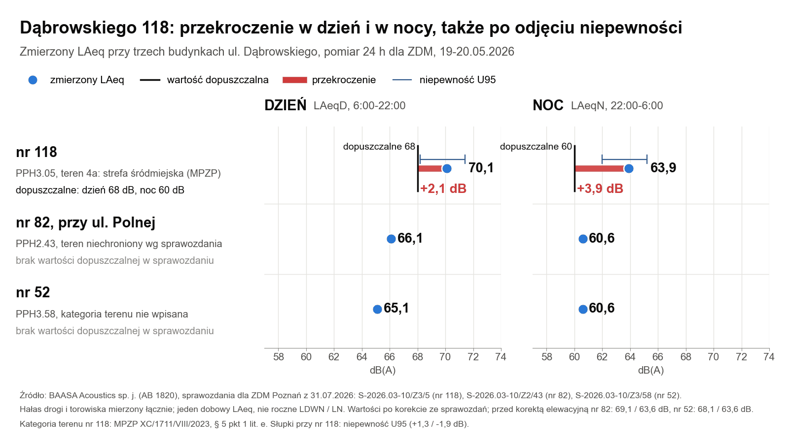
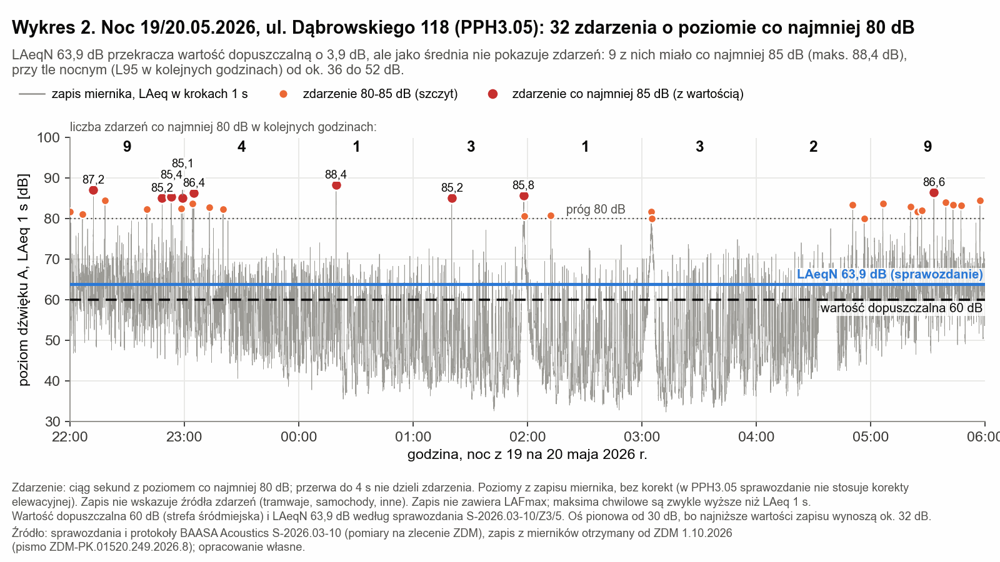
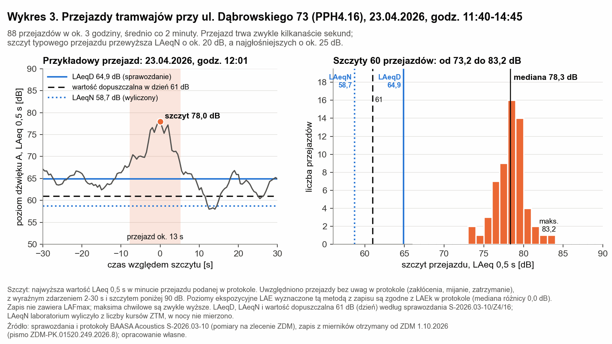
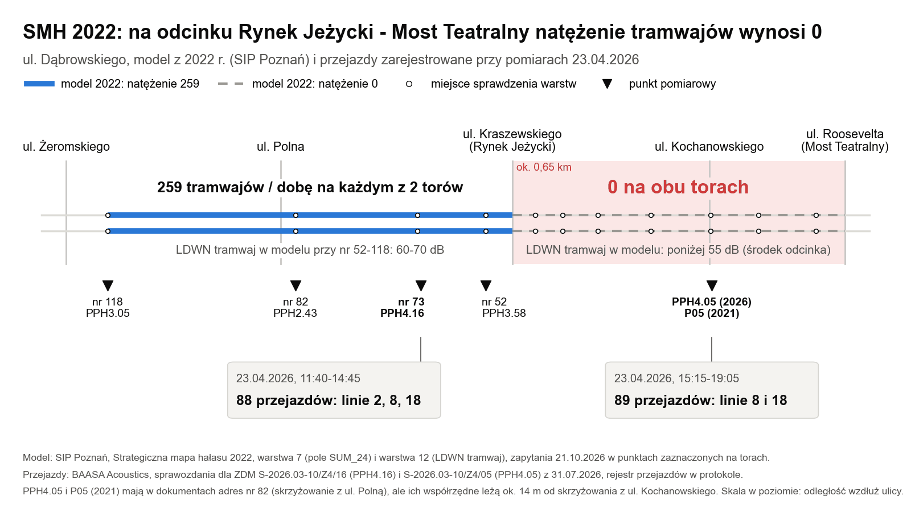
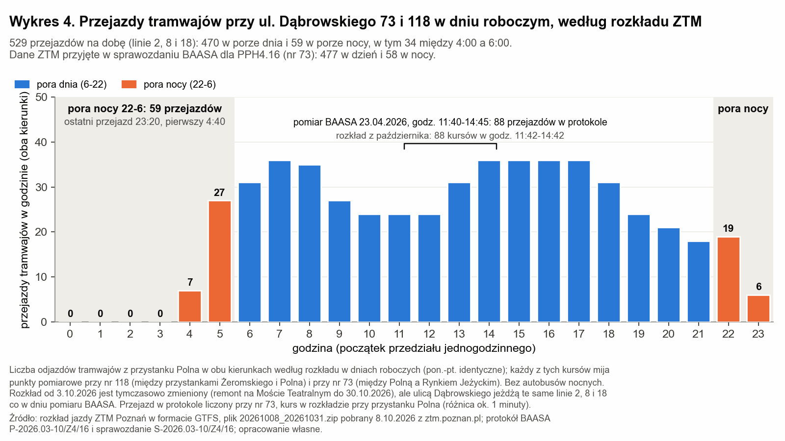

# Ul. Dąbrowskiego: dane dla strategicznej mapy hałasu 2027

Stan: 29.10.2026. Dane wejściowe dla odcinka ul. Dąbrowskiego (Jeżyce) od ul. Żeromskiego do Mostu Teatralnego, zebrane przez mieszkańca ul. Dąbrowskiego dla wykonawcy Strategicznej mapy hałasu miasta Poznania 2027 (konsorcjum AKUSTIX sp. z o.o. i LEMITOR Ochrona Środowiska sp. z o.o.), zamawiającego (Wydział Klimatu i Środowiska UMP, KSr) i mieszkańców. [rachunek] = obliczenie własne, [ocena] = wniosek własny. Korespondencja z instytucjami: [chronologia](chronologia.md).

## Mapa 2027: co wynika z zamówienia

- Zamówienie UMP ZPb-II.271.78.2026.DK (BZP 2026/00322955, wynik 2026/BZP 00410731), umowa z 26.08.2026, wykonanie do 30.07.2027 (KSr-IX.271.37.2026). Mapę 2022 wykonało konsorcjum AkustiX i LEMITOR.
- OPZ: kalibracja i walidacja modelu "w oparciu o: wyniki okresowych pomiarów hałasu drogowego i tramwajowego z 2026 r.", po ocenie ich przydatności. Zamawiający przekazuje m.in. "dane dotyczące linii tramwajowych (osie torów, konstrukcja torowiska, stan techniczny, prędkość dopuszczalna)", natężenie ruchu za 2026 r. (dzień, wieczór, noc) i "Skargi na hałas zgłoszone w latach 2022-2026".
- Pomiary wykonawcy: "w 20 punkach wskazanych przez Zamawiającego, lub większej liczbie, zgodnie ze złożoną ofertą", w tym co najmniej 10 "dla celów kalibracji modelu obliczeniowego oraz z uwagi na zgłaszane wnioski dot. uciążliwości akustycznych".
- ZDM przekazał wyniki pomiarów 2026 "na płycie CD" Wydziałowi Klimatu i Środowiska pismem z 29.09.2026 (ZDM-PK.01520.249.2026.13).
- Rozporządzenie w sprawie SMH (t.j. Dz.U. 2024 poz. 255), zał. 1 ust. 1: na mapie miasta "ujmuje się dane dla wszystkich odcinków dróg publicznych, odcinków linii kolejowych i tramwajowych"; kalibracja: średni błąd bezwzględny do 2,0 dB (Dz.U. 2026 poz. 621).

## Najważniejsze dane

1. **Model 2022: 0 tramwajów na odcinku.** SIP, SMH 2022, warstwa 7 "Hałas tramwajowy - średnie dobowe natężenie ruchu" (SUM_24): 259 na każdym z dwóch torów przy nr 52-118, **0 na obu torach** od węzła z ul. Kraszewskiego (Rynek Jeżycki) do Mostu Teatralnego, ok. 0,65 km [rachunek]. Warstwa 12 (LDWN, tramwaj) tam: "-10-55 dB", przy nr 52-118: 60-70 dB. Przyczyna: nieustalona. 2 x 259 = 518 jest bliskie 529 kursom z rozkładu 2026 [ocena].
2. **Przejazdy na tym odcinku.** PPH4.05, 23.04.2026, 15:15-19:05: 89 przejazdów (linia 18: 45, linia 8: 44) wg protokołu BAASA. Dla porównania PPH4.16 (nr 73), 11:40-14:45: 88 (linia 2: 30, 8: 29, 18: 29).
3. **Nr 118 (PPH3.05)**, pomiar drogowy ulicy z torowiskiem, 19-20.05.2026: 70,1 / 63,9 dB przy dopuszczalnych 68/60 dB (teren 4a, MPZP XC/1711/VIII/2023), przekroczenie także po odjęciu niepewności. Pomiaru tramwajowego przy nr 118 w 2026 r. nie było.
4. **Nr 73 (PPH4.16)**, tramwaj, 23.04.2026: LAeqD 64,9 dB; sprawozdanie przyjmuje 2b i 61 dB, powołując MPZP VII/84/VIII/2019, który w § 5 ust. 2 pkt 1 ustala standard strefy śródmiejskiej (68/60 dB). ZTM (W-ZTM-16212-2026 z 28.10.2026): po stronie nr 73 standard 68/60 dB, bez przekroczeń; strona przeciwna poza MPZP, wg ZTM 65/56 dB. Noc tramwajowa nie była mierzona.
5. **LAE przejazdów** (średnie klas taboru): 83,3-86,7 dB przy nr 73 (7,5 m, "Stan torowiska: Dostateczny") i 70,7-72,8 dB przy ul. Kochanowskiego (10,5 m, "Bardzo dobry"); w obu torowisko "Wspólne z jezdnią", asfalt między szynami. Mediana prędkości: 21 i 26 km/h [rachunek].
6. **Opis punktu kalibracyjnego.** P05 (2021) i PPH4.05 (2026) opisano jako "ul. Dąbrowskiego 82 (skrzyżowanie z ul. Polną)", a ich współrzędne leżą ok. 14 m od skrzyżowania z ul. Kochanowskiego, na odcinku z natężeniem 0. Ul. Polna jest przy nr 82 (PPH2.43).
7. **Rozkład ZTM** (GTFS, dzień roboczy, październik 2026, przystanek Polna): 529 kursów linii 2, 8, 18 na dobę (265 w kierunku Rynku Jeżyckiego, 264 w kierunku ul. Żeromskiego); dzień 6-18: 376, wieczór 18-22: 94, noc 22-6: 59; ostatni ok. 23:20, pierwszy ok. 4:40 [rachunek]. ZTM dla 23.04.2026 (sprawozdanie PPH4.16): 477 w dzień, 58 w nocy.

## Punkty pomiarowe

| Punkt | Rok, rodzaj | Opis w dokumencie | Położenie wg współrzędnych | WGS84 (szer., dł.) | Mikrofon: wys. / odl. |
|---|---|---|---|---|---|
| PPH3.05 | 2026, drogowy | ul. J. H. Dąbrowskiego 118 | nr 118, ok. 100 m od ul. Żeromskiego | 52.415006, 16.892714 | 4 m / 8 m od źródła, 2,8 m od elewacji |
| PPH2.43 | 2026, drogowy | ul. J. H. Dąbrowskiego 82 | nr 82, ok. 25 m od ul. Polnej | 52.413861, 16.897967 | 4,8 m / 6,3 m, 0,8 m od elewacji |
| PPH4.16 | 2026, tramwajowy | ul. Dąbrowskiego 73 | odcinek Rynek Jeżycki - Polna | 52.413272, 16.901589 | 4 m / 7,5 m, 15 m od elewacji |
| PPH3.58 | 2026, drogowy | ul. J. H. Dąbrowskiego 52 | nr 52, na zachód od ul. Kraszewskiego | 52.412708, 16.903306 | 4,7 m / 3 m, 0,8 m od elewacji |
| PPH4.05 | 2026, tramwajowy | ul. Dąbrowskiego 82 (skrzyżowanie z ul. Polną) | ok. 14 m od ul. Kochanowskiego, odcinek Rynek Jeżycki - Most Teatralny | 52.411511, 16.909783 | 4 m / 10,5 m |
| P05 | 2021, tramwajowy | ul. Dąbrowskiego 82 (skrzyżowanie z ul. Polną) | ok. 3 m od PPH4.05 | 52.411506, 16.909742 | 4 m / 12,0 m od osi toru |
| P16 | 2021, tramwajowy | ul. Dąbrowskiego 73 | ok. 7 m od PPH4.16 | 52.413289, 16.901497 | 4 m / 10,8 m od osi toru |
| P37 | 2021, tramwajowy | ul. Dąbrowskiego (róg ul. Szamotulskiej) | na zachód od ul. Żeromskiego | 52.416269, 16.886633 | 4 m / 23,4 m od osi toru |

Punkty 2021 wg SMH 2022 (Tab. 22-23), także drogowe P43 (nr 82) i P05 (nr 116): [punkty-pomiarowe.csv](punkty-pomiarowe.csv).

## Wyniki pomiarów ZDM 2026

BAASA Acoustics sp. j. (AB 1820) na zlecenie ZDM, sprawozdania S-2026.03-10 z 31.07.2026.

| Punkt | Rodzaj, data | LAeqD / LAeqN [dB] | U95 [dB] | Kategoria terenu wg sprawozdania | Dopuszczalne [dB] | Różnica [dB] |
|---|---|---|---|---|---|---|
| PPH3.05, nr 118 | drogowy z torowiskiem, 19-20.05 | 70,1 / 63,9 | +1,3 / -1,9 | 4a, strefa śródmiejska (MPZP) | 68 / 60 | +2,1 / +3,9 |
| PPH2.43, nr 82 | drogowy z torowiskiem, 19-20.05 | 66,1 / 60,6 (przed korektą elewacyjną 69,1 / 63,6) | +1,1 / -1,3 | "Tereny niechronione" | brak | brak |
| PPH3.58, nr 52 | drogowy z torowiskiem, 19-20.05 | 65,1 / 60,6 (68,1 / 63,6) | +1,2 / -1,4 | nie wpisano ("Wybierz") | brak | brak |
| PPH4.16, nr 73 | tramwajowy, 23.04, 11:40-14:45 | 64,9 / 58,7* | +1,2 / -2,1 | 2b (plan VII/84/VIII/2019: standard śródmiejski) | 61 / brak (plan: 68 / 60) | +3,9 / brak (przy 68 dB: -3,1) |
| PPH4.05, ul. Kochanowskiego | tramwajowy, 23.04, 15:15-19:05 | 51,5 / 45,4* | +1,3 / -2,3 | "Tereny niechronione" | brak | brak |

\* LAeqN wyliczony z liczby kursów ZTM; w nocy nie mierzono. Pomiary drogowe obejmują hałas drogi i torowiska łącznie. Wynik to dobowy LAeq z jednego dnia, nie roczne LDWN/LN. Pomiary poprzedziły roboty torowe MPK od 01.08.2026 (wymiana odcinków szyn bez zmiany konstrukcji). Ruch w dobie pomiaru, uwagi: [wyniki-pomiarow-2026.csv](wyniki-pomiarow-2026.csv).

| Klasa taboru | Kursy dzień / noc (ZTM, 23.04.2026) | LAEk PPH4.16 [dB] | LAEk PPH4.05 [dB] |
|---|---|---|---|
| Konstal 105N | 61 / 5 | 83,3 | 70,7 |
| Moderus Beta | 76 / 13 | 84,8 | 71,8 |
| Moderus Gamma | 244 / 27 (PPH4.05: 243 / 28) | 86,7 | 72,8 |
| Solaris Tramino | 54 / 8 | 84,1 | 71,5 |
| Siemens Combino | 42 / 5 | 85,2 | 72,8 |

Rejestr 177 przejazdów z protokołów (linia, tabor, prędkość, LAEk): [rejestr-przejazdow-tramwajow-2026-04-23.csv](rejestr-przejazdow-tramwajow-2026-04-23.csv). Zapisy z mierników (LAeq co 0,5-1 s) i ich porównanie z protokołami: [dane BAASA 2026](../dane/baasa-2026-surowe-dane-README.md). Sprawozdań laboratorium nie publikujemy (zawierają dane osobowe); przekazał je ZDM pismem ZDM-PK.01520.249.2026.5 z 16.09.2026.

## Natężenie tramwajów: model 2022 i rozkład 2026

Warstwy 7, 12 i 13 w 12 punktach kontrolnych (SIP, 21.10.2026): [model-smh-2022-warstwy-tramwajowe.csv](model-smh-2022-warstwy-tramwajowe.csv). Kursy na godzinę wg linii, kierunków i pór doby: [przejazdy-tramwajow-rozklad-ztm-2026-10.csv](przejazdy-tramwajow-rozklad-ztm-2026-10.csv). Rozkład od 03.10.2026 jest tymczasowy (remont na Moście Teatralnym); na ul. Dąbrowskiego te same linie co w dniu pomiaru.

## Torowisko i stanowiska instytucji

- SMH 2022 (s. 63-66): "Wszystkie torowiska przyjęto jako nawierzchnie normalnie utrzymane (Railhead roughness=3)"; w całym mieście 2 typy torowisk (podkłady betonowe, Track base=2, albo drewniane, Track base=8); jeden typ pojazdu TRAM ("nie dokonuje się podziału na typy tramwajów"). Poprawki kalibracyjne +4,0 dB w P05, P16 i P37, przypisane "dla całego jednorodnego odcinka torowiska tramwajowego"; średni błąd kalibracji 1,9 dB.
- MPK (07.08 i 12.08.2026): po robotach z sierpnia konstrukcja toru bez zmian; "stan przedmiotowego tory jest zły a konstrukcja przestarzała"; szlifowanie od Mostu Teatralnego do pętli Ogrody planowane na XI-XII 2026.
- ZTM (22.09.2026): drgania od taboru przenoszą się na budynki; przebudowa pełnego przekroju torowiska na lata 2029-2030, jeśli będą środki.
- ZTM (28.10.2026): na odcinku obowiązuje ograniczenie prędkości tramwajów do 20 km/h (o zasięg zapytano 29.10, daty wprowadzenia ZTM nie podał; mediana zmierzona 23.04.2026: 21 km/h przy nr 73, 26 km/h przy ul. Kochanowskiego); szlifowanie szyn w 2026; przebudowa nieujęta w żadnym planie finansowym. Notatka: [W-ZTM-16212-2026](../odpowiedzi/2026-10-28_ztm-w-ztm-16212-2026.md).
- ZDM (19.10.2026): na przebudowę ul. Dąbrowskiego (Roosevelta - Żeromskiego) 250 000 zł (2026) i 2 000 000 zł (2027); przebudowa torowiska "obecnie tylko założeniem projektowym".
- Marszałek Województwa (18.08.2026): odcinek objęty działaniem PHT4 programu ochrony środowiska przed hałasem.

Cytaty i znaki pism: [chronologia, cz. 3](chronologia.md#3-stanowiska-instytucji-cytaty).

## Pytania do wykonawcy i zamawiającego

1. Z czego wynikało 0 na odcinku Rynek Jeżycki - Most Teatralny w modelu 2022 i skąd będą dane o ruchu tramwajów do mapy 2027 (dla każdego toru, osobno dzień, wieczór i noc)?
2. Jaką konstrukcję torowiska, chropowatość szyn, styki i rozjazdy oraz dodatek na łukach przyjmie model dla ul. Dąbrowskiego (tor wspólny z jezdnią, asfalt między szynami, stan według MPK zły)?
3. Czy wyniki ZDM z 2026 r. posłużą do kalibracji i czy PPH4.05 oraz P05 zostaną przypisane do rzeczywistego miejsca pomiaru (ul. Kochanowskiego, odcinek z natężeniem 0), a nie do opisu "skrzyżowanie z ul. Polną"?
4. Czy przy nr 118 będzie punkt pomiaru hałasu tramwajowego, także w porze nocy, wśród punktów "z uwagi na zgłaszane wnioski dot. uciążliwości akustycznych"?
5. Do kiedy i do kogo zgłaszać uwagi do danych wejściowych i czy wyniki dla tego rejonu zostaną pokazane mieszkańcom przed oddaniem mapy?

## Źródła

- SMH miasta Poznania 2022, część opisowa (07.06.2022): [poznan.pl](https://www.poznan.pl/mim/public/main/attachments.att?co=show&instance=1017&parent=115390&lang=pl&id=380818), Tab. 22-23 (s. 42-48), s. 63-66; dostęp 21.10.2026.
- SIP Poznań, usługa SMH 2022: `https://wms1.geopoz.poznan.pl:6443/arcgis/rest/services/sip/strategiczna_mapa_halasu_2022/MapServer`, warstwy 7, 12, 13; zapytania 21.10.2026.
- Postępowanie SMH 2027: [platformazakupowa.pl/transakcja/1338175](https://platformazakupowa.pl/transakcja/1338175), OPZ cz. I-III; BZP 2026/00322955, 2026/BZP 00410731.
- Sprawozdania BAASA S-2026.03-10 z 31.07.2026 (ZDM-PK.01520.249.2026.5); zapisy z mierników (ZDM-PK.01520.249.2026.8).
- Rozkład ZTM Poznań, GTFS 20261008_20261031.zip ([ztm.poznan.pl](https://www.ztm.poznan.pl/pl/dla-deweloperow/getGTFSFile/?file=20261008_20261031.zip), pobrany 08.10 i 21.10.2026), przystanek Polna, dni robocze (service_id 1, 5, 7: ten sam wynik).
- MPZP: XC/1711/VIII/2023 (rejon ulic J. H. Dąbrowskiego, A. Szamarzewskiego i Polnej), § 5 pkt 1 lit. e; VII/84/VIII/2019 (Jeżyce - Północ, cz. C), § 5 ust. 2 pkt 1.
- Prawo: POŚ (t.j. Dz.U. 2025 poz. 647), art. 118; rozporządzenie w sprawie SMH (t.j. Dz.U. 2024 poz. 255) i zmiana Dz.U. 2026 poz. 621.
